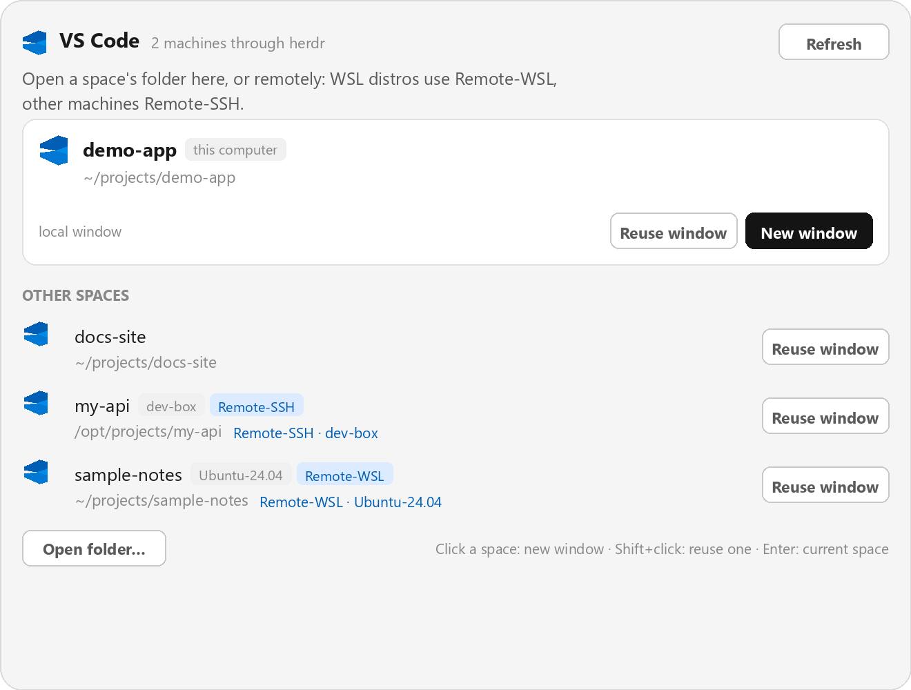

# herdr-mod-vscode

Herdr mod to open VS Code for any space — **local**, **WSL2**, **Remote-WSL**, and **remote over SSH** — from one dialog.



## Install

Copy the folder into your Herdr home:

```sh
# from this repo:
cp -r mods/vscode ~/.config/herdr-app/mods/vscode
herdr-app check ~/.config/herdr-app/mods/vscode
```

Then bind a key in `~/.config/herdr-app/keys.json`, e.g.:

```json
{ "global": { "alt-shift-v": "mod.open:vscode" } }
```

The [RECIPE.md](RECIPE.md) is the full brief another agent can build it from.

## How it works

- **Local space** → `code --new-window <live folder>`
- **WSL2 distro on this PC** (detected via `wsl.exe -l -q` + `hostname` + `hc machine ls --json`) → `code --new-window --remote wsl+<distro> <live folder>`
- **Remote machine** → `code --new-window --remote ssh-remote+<target> <live folder>`, where `<target>` comes from `hc machine ls --json`. This uses the VS Code **Remote-SSH** extension.

The folder is the live one (`panes()[].cwd` of the space's first terminal), not the `space.folder` the space was created with.

Optional: add a button in your tab bar (e.g. next to Files) that runs `run("mod.open", { name: "vscode" })` to open the same dialog without a keybinding.
