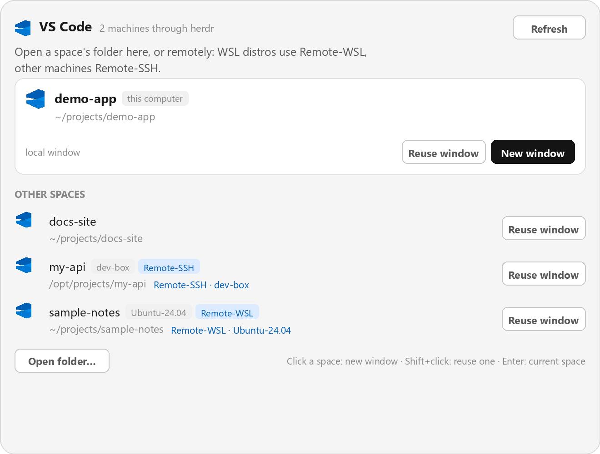

# VS Code

Open any Herdr space's live folder in Visual Studio Code — local, on a WSL2 distro of the same PC, or on a remote machine over SSH — from a single dialog.

## What you see

A centered dialog (660 px, `place: "none"` overlay). At the top: the VS Code glyph, the title "VS Code", a subtitle with the count of machines visible through herdr, and a **Refresh** button.

Below that, one highlighted card for the active space: 22 px VS Code icon, the space name (14 px semibold), badges for its machine and route (`this computer`, `Remote-WSL`, or `Remote-SSH`), and its live folder underneath in muted text. On the card's bottom row: the route detail (`local window`, `wsl target FW-Ubuntu26`, or `ssh target <target>`) on the left, and **Reuse window** (raised) / **New window** (primary) buttons on the right.

Under a "OTHER SPACES" heading, a scrollable list (max height 330 px) of every other space: an 18 px icon, the name, a `current` badge on the active one, the machine badge when remote, the live folder, and `Remote-WSL · <distro>` or `Remote-SSH · <target>` on the right when remote. Each row has its own **Reuse window** button. While a space is opening, its buttons are replaced by a spinner and "Opening".

At the bottom: an **Open folder…** button (system folder picker, opened locally) and a muted footer hint. An error (machine list or `code` failure) appears as a red banner across the top of the dialog, and failed opens also raise an error notification.

## How it behaves

- The space's folder is read live: the first terminal's `panes()[].cwd` across the space's tabs, falling back to `space.folder` and then `home`. `space.folder` never moves, so a terminal that `cd`s elsewhere would open the wrong project.
- Opening runs `code` with `--new-window` (row click, **New window**, or `Enter`) or `--reuse-window` (row's **Reuse window** button, `Shift+click`, or `Shift+Enter`). The dialog closes on success and stays open with a banner on failure.
- Local spaces (`machine: null`) open in a local VS Code window.
- Remote spaces open remotely: a machine whose `host` is this PC and whose `target`/name matches an installed WSL distro (from `wsl.exe -l -q`, exact match wins, then a fuzzy `includes` match so `Ubuntu26` finds `Ubuntu-26.04`) opens through the **Remote-WSL** extension with `--remote wsl+<distro>`. Every other machine opens through **Remote-SSH** with `--remote ssh-remote+<target>`, where `<target>` is `hc machine ls --json`'s `target`.
- `Enter` (no Ctrl/Alt/⌘) opens the active space, `Shift+Enter` reuses its window. `Esc` closes the dialog. **Refresh** re-reads `hc machine ls` and the WSL distro list.
- The VS Code icon is accent-colored for Remote-WSL (`t.done`), accent for Remote-SSH, and muted for local rows.
- The mod runs programs: `hc machine ls --json`, plus `wsl.exe -l -q` and `hostname` on Windows. On Windows, `code` is resolved through `cmd.exe /d /c code` because `code.cmd` cannot start directly via `CreateProcess`.

## Built from

- `mods/vscode/main.js` — the whole dialog (a `View` subclass from `gpui-kit`, `v_flex`/`h_flex` from `gpui-base`).
- `mods/vscode/mod.json` — `{ "place": "none", "title": "VS Code", "overlay": { "kind": "dialog", "width": 660 } }`.
- `mods/vscode/code.svg` — bundled VS Code glyph (`fill="currentColor"`).
- `mods/workspace-chrome/spinner.svg` — spinner while a space is opening.
- `herdr` imports: `exec`, `hc`, `notify`, `props`, `closeOverlay`, `pickFolder`, `spaces`, `panes`, `theme`, `window`.
- Programs run: `code` (or `cmd.exe /d /c code` on Windows), `wsl.exe -l -q` and `hostname` (Windows only, for WSL routing).

## Watch out

- `wsl.exe` answers in UTF-16LE, so stdout carries NUL bytes — strip `\u0000` and `\r` before splitting into distro names.
- Only route to `wsl+<distro>` when the machine's `host` matches this PC's normalized hostname. A remote machine that merely shares a name must stay on `ssh-remote+`.
- Remote-SSH genuinely fails against WSL distros exposed over SSH on the same PC (connection never establishes even though plain `ssh` works), so WSL routing is not just faster here — it is the only way the window opens. `remote.SSH.useExecServer: false` does not fix it; do not leave that setting behind.
- `exec("code", …)` rejects with "program not found" on Windows because `code` is `code.cmd`; fall back to `cmd.exe /d /c code …`.
- The dialog takes the keyboard with a focus handle refocused 60 ms after `init`, because it mounts after `init`. The `Enter` handler must take its own `(e, cx)`.
- `spaces()` re-renders on change; `panes()` is read inside `place()` per call, so the displayed and launched folder is always the live one.

## Done when

- `herdr-app check ~/.config/herdr-app/mods/vscode` passes.
- Opening the dialog on a local space shows `this computer` and `local window`; pressing `Enter` opens that folder locally.
- Opening it on a WSL-backed machine shows `Remote-WSL` and `wsl target <distro>`; `code --status` shows the window with `[WSL: <distro>]`.
- Opening it on a real remote shows `Remote-SSH` and `ssh target <target>`, and the window connects over Remote-SSH.
- A space whose first terminal `cd`ed to another folder opens that folder, not its creation folder.
- `Alt+Shift+V` in `keys.json` (`"alt-shift-v": "mod.open:vscode"`) opens the same dialog, and a tab-bar button calling `run("mod.open", { name: "vscode" })` opens it too.
